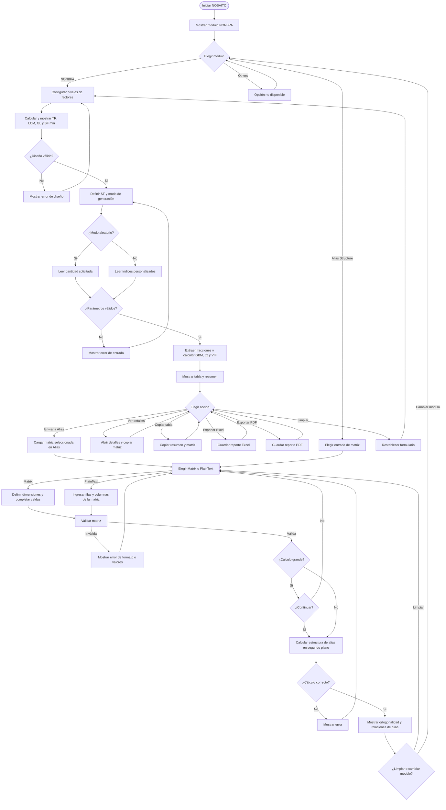

# Diagrama de flujo del programa

El siguiente diagrama resume la navegación principal, la generación NONBPA y el análisis de alias. Los cálculos se ejecutan en segundo plano; los resultados y errores se muestran en la interfaz.

